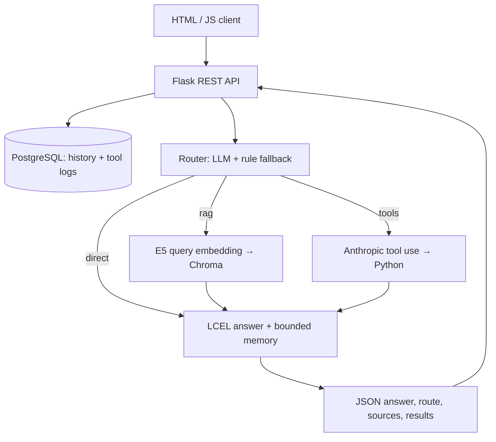

# Architecture / ארכיטקטורה

## Request flow

1. Flask validates JSON, loads the signed-cookie session and fetches history from PostgreSQL.
2. The router always runs for `/chat`. A structured tool attachment takes priority. Otherwise the model classifies the request and produces a standalone search query. Failure invokes conservative rules; this is visible in the JSON and UI.
3. RAG embeds the query locally using multilingual E5 and calls Chroma by HTTP. Retrieval returns source text, lecture/page/slide metadata and cosine scores. There is no browser-to-vector-store connection.
4. Tool requests expose Anthropic schemas to Claude. The resulting named call is dispatched only through a whitelist. Python output is persisted before it is returned as `ToolMessage`. Explicit user form data overrides model modifications to that graph. Limits prevent unlimited tool loops (three rounds, four calls).
5. The final answer uses LCEL with the system rules, bounded history, excerpts and exact final tool outputs. Long traces are abbreviated only in the model context; the UI and DB retain the complete bounded trace. Retries are handled by ChatAnthropic. Degraded output is labelled.
6. The answer and structured payload are stored, then returned as JSON. Sources are displayed as retrieved sources, not a proof that every sentence was supported.

The separate `/tools/run` calculator calls Python directly and logs every invocation. It does not masquerade as an LLM route. Users can run it without a model key and attach the same input to `/chat` for an explanation.

## Database mapping

| Table | Fields / purpose |
|---|---|
| `conversations` | Session UUID, creation time |
| `messages` | UUID, session FK, user/assistant role, text, JSON payload, timestamp |
| `tool_calls` | UUID, session FK, request UUID, tool name, input JSON, output JSON, ok/error, timestamp |

SQLAlchemy parameterizes DB access. The committed SQL migration initializes fresh PostgreSQL volumes; `create_all` also supports the standalone app and test fixtures. Future schema changes need numbered migrations rather than relying on `create_all` to alter tables.

## Course ingestion

PDF quadrants → normalized slide text → tokenizer-aware overlapping chunks → normalized E5 vectors → Chroma HTTP upsert. The embedding model identity is recorded in collection metadata and checked at query time. Original PDFs remain available through Flask source links.

No visual interpretation is performed on PDF diagrams. Extracted text is course evidence with known limitations, not a lossless conversion of the slides. Lecture numbers come from filenames because a few headers in the supplied material are inconsistent.

## Operational choices

- Python 3.12; Flask, PostgreSQL 16, Chroma 1.5.9 in separate services.
- CPU embedding model and a persistent model cache; GPU is unnecessary.
- Same-origin client, no CORS wildcard, secrets on the server, JSON request-size limits, safe text rendering rather than HTML from model output.
- HTTP-only signed session cookie with SameSite=Lax; local Compose ports bound to 127.0.0.1. For HTTPS deployment, set COOKIE_SECURE=1 and design proxy/auth handling explicitly.
- One Gunicorn worker and four threads, with per-session in-process locking. This is an academic local deployment, not a multi-user public SaaS configuration.
- SQLite is used only by automated tests. Full mode requires PostgreSQL.

## Requirements traceability

| Specification item | Implementation |
|---|---|
| Client → server → database | `static/app.js` → `web.py` → `storage.py` |
| Router before RAG/tools/LLM | `agent.Router.decide`, called by every `Tutor.process` |
| Anthropic tools, at least two | 12 `TOOL_SCHEMAS`, `Tutor.tool_loop` |
| Retrieval with scores | `Retriever.search` using Chroma cosine |
| LCEL final prompt | `Tutor.chain` |
| Memory | PostgreSQL history + `MessagesPlaceholder` |
| Flask REST endpoints | `/chat`, `/history`, `/health` plus calculator/catalog/PDF routes |
| Docker relational DB | `compose.yaml`, `migrations/001_init.sql` |
| Tool input/output logs | `tool_calls`, success and failure |
| Loading, errors, route and sources | `static/app.js` |
| Reproducible docs, diagram, reflection, demo | README HE/EN and `docs/` |

